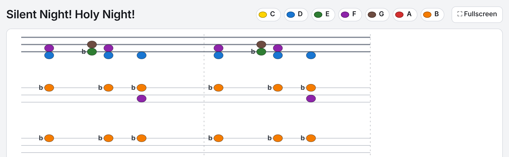

# 🎹 Easy Piano Note System

A new piano notation system where you don't need to learn all the traditional notes.
Designed to make piano learning easier, faster, and more enjoyable — especially for beginners and visual learners.

**[▶ Try it in your browser](https://practicalengineering.github.io/Easy-Piano-Note-System/)** – open any MusicXML file and see it in this system. Nothing is uploaded.



## 🌱 Why this system?

In the normal system, you need to memorize every single note on the sheet before you can play.
With this system, you only need to learn 7 main notes — after that, the pattern repeats, just like on a real piano.

## ⚙️ How it works

A piano has 88 keys, but they follow a repeating 7-note pattern: **C D E F G A B**.

This system uses the same 7 main notes, but visually repeats them after each octave. Once you understand the first set, you can read any note on the keyboard — no matter how high or low.

🎵 *"Learn 7 notes — play 88 keys."*

| Place in the block | Note | Color |
|---|---|---|
| top line | B | orange |
| between | A | red |
| middle line | G | brown |
| between | F | purple |
| bottom line | E | green |
| just below | D | blue |
| lowest place | C | yellow |

- Every octave has 3 lines. The block from **C4** (middle C) has thicker lines – count the octaves up and down from it.
- Distance to the right = time. A vertical stroke = rest. A faint dashed line = barline.
- Sharps and flats stand to the left of every note (`#`, `b`), because there is no key signature.

## 💡 Why it helps

Many people would love to play the piano, but give up early because reading notes feels too hard.
This system makes reading simple, logical, and visually intuitive.

My first piece I learned was "Sweden" (by C418 from Minecraft). It covers nearly half the piano's range, and yet it was easy to read and play thanks to this system.

## 🧭 Vision

I want this to be open source, freely available, and used for learning and creativity — to make music more accessible for everyone.
Everything is shared freely, with no ads, and open for community contribution.

*"To the glory of God — that more people may find joy in music."*

---

## How to convert a song

1. Get the song as **MusicXML** (`.mxl`, `.musicxml` or `.xml`): export it from MuseScore, Sibelius, Finale or Dorico (*File → Export → MusicXML*), or download it from a free archive such as the [Choral Public Domain Library](https://www.cpdl.org) or [Mutopia](https://www.mutopiaproject.org).
2. Open the [web page](https://practicalengineering.github.io/Easy-Piano-Note-System/) (or `index.html` from this repository – a double-click is enough).
3. Click **Open MusicXML** or drop the file on the page.

That's it. The page draws the song in this system, shows every chord on a keyboard, and can save it as PNG or SVG or print it. **Fullscreen** shows only the notes, for playing at the piano. The page is in English and German.

Please only convert music you are allowed to use. Most hymns written before 1929 are in the public domain; modern songs usually are not.

## Notencode

Behind the picture there is a plain-text form of the same music, *Notencode*:

```
F4+D4+bb3+bb2
G4+Eb4
F4+D4+bb3+bb2
D4+Bb3+f3+bb2
```

One line per moment a key is struck. CAPITALS = right hand, lowercase = left hand, `+` = struck together, highest note first, one blank line between measures. Notes that keep sounding are not repeated. The full rules are in [SPEC.md](SPEC.md).

### Command line

For many files at once there is `notencode.py` (Python 3.8 or newer, no extra packages):

```
python notencode.py examples/silent_night.mxl
python notencode.py input/song.mxl -o output/song.txt
python notencode.py                       # converts every file in input/
```

On Windows you can also put files into `input/` and double-click `convert.bat`. For every file three files are written to `output/`:

| File | What for |
|---|---|
| `NAME_notencode.txt` | the Notencode |
| `NAME_notencode.checklist.txt` | the same code with measure, beat and the notes that keep sounding – for comparing with the printed score |
| `NAME_notencode.report.txt` | report: every note of the file accounted for, warnings, places to check |

| Option | Meaning |
|---|---|
| `--accidentals sounding` (default) / `written` | the key you press, or only the printed accidentals |
| `--same-pitch-slur hold` (default) / `restrike` | a slur between two equal notes looks like a tie – hold the note, or strike it again |
| `--hands playable` (default) / `staff` | `playable`: the same note in both hands only once, hands never cross; `staff`: hand = staff |
| `--upper P1 --lower P2` | which staves belong to which hand, if the file has more than two (e.g. choir + piano): `--upper P5/1 --lower P5/2` or `--upper P1,P2 --lower P3` |

## How reliable is it?

The converter reads the file note by note with fixed rules. It never guesses: the same file always gives the same output.

- **51 automated tests** cover timing, triplets, ties across measures, slurs, unisons, pickups, grace notes, voice crossing and `.mxl` archives.
- **Note balance**: every `<note>` element of the file is accounted for exactly once (struck, tie continuation, rest, …). The report says so.
- **Independent cross-check**: `tools/crosscheck_music21.py` reads the same file with the [music21](https://web.mit.edu/music21/) library and compares the result line by line.
- **Web page and Python agree**: `tools/build_html/compare_js_python.js` runs the web page's converter on all test cases and checks that the output is identical, character by character.

It can only be as correct as the MusicXML file. The checklist and the report point to the places worth comparing with the printed score.

## Development

```
python -m unittest discover -s tests -v        # tests (or double-click run_tests.bat)
python tools/build_html/build.py               # rebuild index.html after changing core.js or template.html
python tools/build_html/record_cases.py        # record the test cases ...
cd tools/build_html && npm install && node compare_js_python.js   # ... and compare JavaScript with Python
pip install music21 && python tools/crosscheck_music21.py examples/silent_night.mxl
```

| Path | Content |
|---|---|
| `index.html` | the web page – built, do not edit directly |
| `notencode.py` | the converter (reference implementation) |
| `tools/build_html/core.js` | the converter in JavaScript (port of `notencode.py`) plus the phrase detection for the rows |
| `tools/build_html/template.html` | page layout, drawing, keyboard, translations |
| `tests/` | tests and reference output |
| `examples/` | Silent Night (public domain) |

Adding a language: in `template.html`, copy the `en` block in `T`, translate the values and add the language to `LANGS`. See [CONTRIBUTING.md](CONTRIBUTING.md).

## Roadmap

- An open library of public-domain hymns in this system, where anyone can add songs.
- More languages for the web page.

## Community

Feel free to tell me what you think about it, which songs you would like to have, or whatever is on your mind.
You can also join the Discord community: https://discord.gg/CXdug2Fw

## License

[MIT](LICENSE). The example *Silent Night* (Franz Xaver Gruber, 1818; text Joseph Mohr) is in the public domain.
